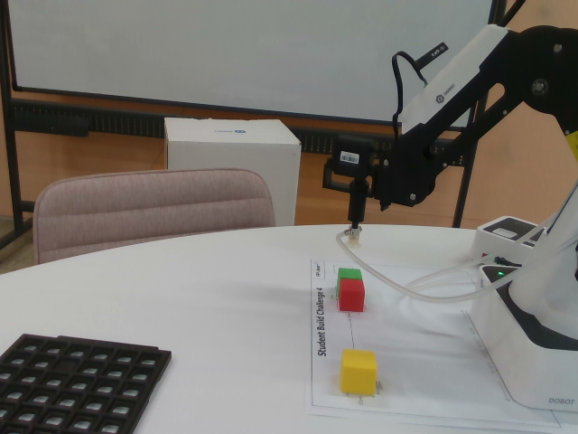

# 2026-10-17 工作记录：Dobot + D435i 标定准备与固定点吸盘搬运

日期与时区：2026-10-17，Asia/Shanghai（UTC+8）。本文把当天对话中的需求、现场示教数据、代码变化和执行记录汇总为可交接文档，不是逐字聊天导出。表内时间使用北京时间；原始 JSON 中的 `*_utc` 保留 UTC。

工作区：`/home/hongjin/Documents/Codex/2026-09-17/new-chat/outputs/dobot_magician_ros2`。

## 1. 当前结论

- 已连接本次 Dobot Magician 和 D435i，完成吸盘开关、原始 A 点取料、10 mm 试抬及 B/C/D 接触点示教。
- 已执行红块 D→A 回收、固定朝向的红块 A→B，以及绿块 A→C。最终 C 路线于 **11:23:06** 完成。
- 最终请求的速度为：高位水平搬运 **50 mm/s**，提起、下降及放下 **30 mm/s**；加速度维持 **10 mm/s²**。速度设置通过控制器参数回读验证，不表示短行程中始终能达到该速度。
- 搬运时锁定实际抓起时的世界朝向 R，不再直接回放各放置点示教时的 R。
- 用户要求取消逐动作人工检查暂停，最后一次执行采用 `start-only`：不再等待 `HELD` / `RELEASED` 输入，实时状态、报警、轨迹偏差和停止保护仍然有效。
- **没有完成相机到机械臂基座的外参标定，也没有完成实际吸盘 TCP 的独立校准。** 当前任务使用机器人示教坐标，不是相机识别后自动生成机器人抓取坐标。
- 本次没有完成固定 R、高位 50 / 升降 30 参数下的完整 A→B、A→C、A→D 三目标连续验收，也没有实现无限补料循环。

## 2. 当天任务需求与范围

用户提供压缩包：`/home/hongjin/Downloads/drive-download-20261017T011723Z-1-001.zip`。已明确允许使用 ROS 2/Python，不必严格使用课件中的 Blockly。

| 原图 | 课件任务 | 本次状态 |
|---|---|---|
| IMG_1755 | Challenge 1：单块 A→B，经过 Above-Pick / Above-Place；图示方块宽、高约 25 mm | 已进行真机固定点抓放验证 |
| IMG_1756 | Challenge 3：每轮从 A 取料，依次放到 B、C、D | A/B/C/D 已示教；实际完成本轮 B、C，D 尚未以最终参数完成 |
| IMG_1757 | 双机器人、输送带、IR、颜色传感器及分色区域的实验布置 | 仅整理要求，额外硬件未完成确认 |
| IMG_1758 | Robot 1 上料，IR 到料停带，Robot 2 取料与分色 | 未实现双机和输送带联动 |
| IMG_1759 | Guided Build 4：外部开关触发、拍摄、AI 分类、固定位置取料、分类放置 | 尚未接入完整触发与分类流程 |

原始要求和实施路线见 [TASK_GUIDANCE_2026-10-17.md](TASK_GUIDANCE_2026-10-17.md)。该文件是早期阶段快照，其中“尚未示教/执行”等描述不代表本文记录时的最终进度。

用户选择的任务模式是 `refill`：**A→B、A→C、A→D，每次都从 A 重新取料**，不是 A→B→C→D 搬同一个方块。随后本轮实际执行范围收窄为 A→B、A→C，用户负责在 A 补料。B/C 已占用后，不能直接再次向同一点放置并假设它仍为空。

人工补料只能在机械臂停稳、人与运动区域隔离的条件下进行；“不逐动作确认”不等于允许在运动路径中伸手，也不等于自动判断 A 有料、目标空闲或吸附成功。

## 3. 设备、环境与接口

| 项目 | 当天确认值 |
|---|---|
| 机械臂 | Dobot Magician，XYZ + yaw 四自由度，本次末端为吸盘 |
| 稳定串口 | `/dev/serial/by-id/usb-1a86_USB_Single_Serial_58EA056287-if00`，当时映射 `/dev/ttyACM0` |
| 相机 | Intel RealSense D435i，SDK 序列号 `233522078258`，USB 3 |
| ROS | ROS 2 Humble，系统 Python 3.10；不使用 Conda base 的 Python 3.13 启动 ROS |
| Python 运行环境 | 工作区 `.venv_ros_mujoco`，使用系统 ROS Python 依赖 |
| 相机流 | 彩色、深度均为 640×480、15 FPS；深度对齐到彩色 |
| 相机节点 | `/camera/camera` |
| 真机状态节点 | `/dobot_state_publisher` |
| 状态话题 | `/dobot_TCP`、`/dobot_joint_states`、`/dobot_alarms` |
| 图像话题 | `/camera/camera/color/image_raw`、`/camera/camera/aligned_depth_to_color/image_raw` |
| 彩色光学系 | `camera_color_optical_frame` |
| 控制器工具偏置 | `[59.70000076293945, 0.0, 0.0]` mm |

工具偏置是控制器已有参数，不是已测出的 TCP 误差；不能随意减去 59.7 mm 来“校准”吸盘。也不能使用会把该偏置置零的旧启动流程后继续回放本次坐标。

当天较早检查曾出现 `0x43 / 0x44 / 0x49` 报警，之后多次采样和最终只读复查为 `[]`。这些阶段需分别记录，不能把历史报警描述当作当前状态，也不能据此认定其原因已被完整诊断。

现有通用夹爪 bridge 不等于本次吸盘任务执行器。通用 bridge 的 `MOVJ_XYZ`、夹爪 TCP 及旧机械臂坐标不得直接套用；本次专用执行器使用 `MOVL` 和当前工具偏置。MuJoCo/Gemini 是既有工程背景，本日以下抓放结果均来自真机任务，不是新完成的仿真或视觉分类结果。

### 3.1 本次复查取得的彩色内参

在 **11:25:09 左右**重新订阅当前 `CameraInfo` 得到：

```text
resolution: 640 × 480
frame_id: camera_color_optical_frame
distortion_model: plumb_bob

K = [606.6097412109375,   0.0,             315.8448181152344,
       0.0,             606.8175048828125, 245.83737182617188,
       0.0,               0.0,               1.0]
D = [0.0, 0.0, 0.0, 0.0, 0.0]
```

这些是当前流的发布值，不是手眼标定结果。换相机、分辨率或相关流配置后，应重新读取，不能将本表作为永久硬编码参数。

## 4. 手眼标定与手机棋盘格检查

### 4.1 已完成的检测

用户使用 Xiaomi 15 Pro 显示棋盘格，并调整位置、放大图案、移开吸盘透明气管。气管曾遮挡角点；移开后连续 3 帧检测到 **5×8 个内角点，共 40 个**。

阶段检测记录包含：RGB 与对齐深度时间差 0 ms、40/40 个角点附近深度有效、点集平面 RMSE 约 0.68 mm、最大平面偏差约 1.88 mm。这是单帧深度平面一致性，不是机器人定位精度或手眼误差。

随后保存的粗估数据见 [board_initial_estimate.json](reports/calibration/2026-10-17/board_initial_estimate.json)：

| 粗估项目 | 记录值 |
|---|---|
| `accepted` | `false` |
| 相机系棋盘中心 | `[-0.0129232, 0.0826470, 0.5639500]` m |
| 相机至棋盘中心距离 | 约 0.57012 m |
| 朝向相机的平面法向 | `[0.0720069, -0.9211965, -0.3823769]` |
| 相机原点到该平面的距离 | 约 0.292706 m，不等于棋盘中心距离 |
| 平面拟合 RMSE | 0.746 mm |
| 深度推算相邻格距中位数 | 11.2653 mm，标准差约 0.8581 mm |
| 深度推算棋盘外框宽 / 高 | 67.5398 / 105.9607 mm |
| `T_base_camera` / `T_base_board` | 均为 `null` |

用户提出按手机宽度估计格距。已有记录引用的小米官方机身尺寸为长 161.3 mm、宽 75.3 mm（[原记录引用的参数页](https://www.mi.com/prod/xiaomi-15-pro/specs)）。假设完整图案横向为 6 格且恰好覆盖机身宽，格距为 12.55 mm；但机身宽不等于实际显示棋盘宽，和 RGB-D 粗测也不一致，因此该值未被接受为实测尺寸。

### 4.2 为什么没有宣布标定完成

- 吸盘实际接触点与控制器上报 TCP 的关系未独立校准，用户也明确表示“不确定”。
- 手机屏幕存在反光、显示缩放及图案边界测量不确定性。
- 没有测得棋盘相对机器人基座的独立位姿。
- 没有保存足够的有效相机—基座对应点，也没有独立验收点误差。
- Dobot 主要只有 yaw 姿态变化，不能把它当作具有充分非平行旋转运动的通用六轴手眼数据。

因此，当天完成的是“棋盘检测、深度诊断、采样工具与流程准备”，不是可部署的相机外参。

### 4.3 后续正式标定方案

优先使用已验证 TCP 对准多个明确物理点，相机取得对应 3D 点，求不带缩放的刚体配准：`p_base = R_base_camera × p_camera + t_base_camera`。建议至少 6 个拟合点、3 个独立验收点，覆盖工作范围并包含高度变化。

工具的默认验收阈值为拟合 RMSE ≤3 mm、拟合最大误差 ≤5 mm、独立验收最大误差 ≤5 mm；这是软件阈值，**不是本次达到的精度**。只有 `accepted=true` 且设备安装关系未变化，才考虑发布 `T_base_camera`。

用户曾提出“先手眼标定，再接触红块确认 TCP”。需要避免循环验证：若外参拟合本身已经用了未知 TCP，不能再用该外参证明 TCP 正确。可改用独立测量的基座/棋盘参考，或先完成 TCP 验证。后续实际走的是手动示教固定点抓放路线。

完整流程见 [HAND_EYE_CALIBRATION.md](HAND_EYE_CALIBRATION.md)。禁止让机械臂按棋盘粗估值盲触手机屏幕。

## 5. 两点相对测量：不要与任务 A/B 混淆

用户提出先回到初始位置，再手动把吸盘放到红块上。实际记录采用保持供电的 Unlock 手动示教，而非断电后假定坐标参考不变。

| 历史两点测量名称 | XYZ，mm | R，° | 本任务中的含义 |
|---|---|---|---|
| 历史 A | `[210.00001525878906, 0.0, 64.99999237060547]` | `0.0` | 当时停稳的待机参考，不是任务取料 A |
| 历史 B | `[204.83059692382812, 69.3899154663086, -45.65318298339844]` | `18.71470069885254` | 原始红块接触点，后来命名为任务 `pick_A`，不是任务放料 B |

两点原始关节：

```text
历史 A：[0.0, 8.615478515625, 27.763797760009766, 0.0] deg
历史 B：[18.71470069885254, 48.07060623168945, 67.55284881591797, 0.0] deg
```

控制器坐标差 `B−A`：

```text
ΔXYZ = [-5.1694183349609375, 69.3899154663086, -110.6531753540039] mm
水平距离 = 69.58220501208109 mm
三维直线距离 = 130.71269437306853 mm
ΔR = 18.71470069885254 deg
```

这里基座方向和总 R 都发生变化，未知水平工具偏置未证明可以抵消。因此这些是控制器参考点的相对位移，不是已独立验证的实际吸盘尖端位移，更不能求出 `T_base_camera`。

原计划退至 `[210,0,80]` mm 的动作未完整到达：一次位姿响应缺失触发停机，最终记录的待机高度约 65 mm；没有执行真正的控制器 homing。不要把“回位”写成“已完成硬件回零校准”。

原始记录：[manual_two_point_A.json](reports/calibration/2026-10-17/manual_two_point_A.json)、[manual_two_point_result.json](reports/calibration/2026-10-17/manual_two_point_result.json)。

## 6. 正式任务 A/B/C/D 示教数据

以下全部是 **Dobot 控制器 XYZ（mm）和 R（deg）**；不是像素转换坐标，也不是已校准吸盘尖端的外部测量值。接触点均为同一红色方块顶面，不是裸桌面，不能再扣一次约 25 mm 方块高度。负 Z 不表示低于桌面。

### 6.1 接触点（便于阅读的舍入值）

| 名称 | X，mm | Y，mm | Z，mm | 示教 R，° | 记录时间 |
|---|---:|---:|---:|---:|---|
| `pick_A` | 204.830597 | 69.389915 | -45.653183 | 18.714701 | 10:22:51 |
| `place_B` | 206.999298 | -63.367401 | -45.263046 | -17.020596 | 10:34:10 |
| `place_C` | 209.579376 | -92.191483 | -47.313728 | -23.744125 | 10:35:50 |
| `place_D` | 210.874908 | -147.769196 | -46.852905 | -35.020599 | 10:37:39 |

B/C/D 身份依据用户现场接触确认；相机侧视图中的标签并非每次都可独立读清。没有通过图片“估算”并替代这些实际示教坐标。

### 6.2 原始精度 XYZ/R 与关节备份

```json
{
  "units": {"position": "mm", "angles": "deg"},
  "controller_tool_bias_mm": [59.70000076293945, 0.0, 0.0],
  "pick_A": {
    "xyz": [204.83059692382812, 69.3899154663086, -45.65318298339844],
    "R": 18.71470069885254,
    "vendor_joints": [18.71470069885254, 48.07060623168945, 67.55284881591797, 0.0]
  },
  "place_B": {
    "xyz": [206.99929809570312, -63.36740112304687, -45.26304626464844],
    "R": -17.020595550537113,
    "vendor_joints": [-17.020593643188477, 47.94572067260742, 67.37850189208984, -0.0000019073486328125]
  },
  "place_C": {
    "xyz": [209.57937622070312, -92.19148254394531, -47.31372833251953],
    "R": -23.74412536621094,
    "vendor_joints": [-23.744123458862305, 51.040321350097656, 64.06710815429688, -0.0000019073486328125]
  },
  "place_D": {
    "xyz": [210.87490844726562, -147.76919555664062, -46.8529052734375],
    "R": -35.020599365234375,
    "vendor_joints": [-35.02059555053711, 57.050655364990234, 54.90747833251953, -0.0000019073486328125]
  }
}
```

权威配置：[task_waypoints.json](reports/calibration/2026-10-17/task_waypoints.json)。本日执行使用的 SHA-256：

```text
342b0e0d101a3d9adbd4997af2ef35941b133b93aaf77a34153fcfd60e426168
```

单点采样详情：[B](reports/calibration/2026-10-17/task_place_B.json)、[C](reports/calibration/2026-10-17/task_place_C.json)、[D](reports/calibration/2026-10-17/task_place_D.json)。这些 JSON 保留了采样当时“尚未验证搬运”的历史状态；后来实际运行结果在独立任务日志中，不覆盖原始示教记录。

### 6.3 高位与几何限制

共用水平搬运高度为控制器 `Z=-10.0 mm`：

| 接触点 | 至搬运平面的抬升量，mm |
|---|---:|
| A | 35.653183 |
| B | 35.263046 |
| C | 37.313728 |
| D | 36.852905 |

约 25 mm 方块经过同高度方块上方时，名义底部净空只有约 10 mm；这是基于当前物料和安装的估计，不是通用安全平面。换高物料、工具、纸张、基座或增加障碍后须重新检查。

B→C 水平间距约 28.94 mm，C→D 约 55.59 mm，并不相等；保留各自示教值，不强行等距。模型检查采用连杆 135 / 147 mm 及当前工具偏置；路径可达不等于完成实物碰撞检测。

## 7. 固定 R、速度与检查策略

### 7.1 方块为什么会旋转，以及处理方法

最初 D→A 回放使用了不同点各自的示教 R，从约 -35.020599° 变至 18.714701°，相差约 53.7353°，所以物体随末端旋转。用户明确要求抓起后保持 R。

当前采用 `--yaw-policy hold`：吸附后读取实际 R 并锁定，将其用于抬升、水平搬运、下降、释放和撤离；不修改原始 XYZ 或覆盖原始示教文件。

当前固件几何约定为 `R_world = J1_base + J4_wrist`。要保持世界 R 不变，底座转动时腕关节需要反向补偿，而不是简单把 J4 固定为零。在参考 R≈18.714701° 时，B/C/D 所需 J4 分别约 35.7353° / 42.4588° / 53.7353°。

### 7.2 最后采用的运行参数

| 项目 | 设置 / 实现 |
|---|---|
| 高位水平速度 | 50 mm/s |
| 提起、下降、放下、撤离速度 | 30 mm/s |
| 加速度 | 10 mm/s² |
| 水平运动 | 高平面单段连续 MOVL，发送前密集检查完整模型路径 |
| 接触附近升降 | 仍采用名义 ≤4.5 mm 小段 MOVL，每段监测反馈并等待到位 |
| 实际抓取 R | 最后绿块为 `18.714704513549805°` |
| 人工检查策略 | 最后执行 `start-only`，取消 HELD / RELEASED 逐动作输入 |
| 吸盘状态 | `[1,1]` 为开启、`[0,0]` 为关闭；只代表控制器输出，无真空传感器证实 |

用户曾先后要求“五倍速度”“50mm”和“提起放下30mm/s”；本文以最终的 **水平 50 / 升降 30 mm/s** 为准，不将速度倍数叠乘。升降仍有小段停稳，加速度也较低，因此“设置 30”不等于连续实测 30 mm/s；若要进一步缩短节拍，需另行验证连续升降轨迹。

本次没有实现无界速度或删除关节保护。当前 CLI 的有限速度校验范围仍为 5–50 mm/s。报警、反馈时效、工具偏置、来源身份、轨迹偏差和异常停机保护未因“直接执行”被关闭。

`start-only` 在普通多目标模式下仍保留每条路线开始前的 `READY A` 补料/清场确认，只跳过抓起和释放的人工确认；它不是自动补料识别或无限循环。控制器输出与位姿检查正常，不足以独立证明每次都吸住或释放成功，日志对此保留 `unverified` 标记。

## 8. 当天主要真机执行记录

| 北京时间 | 动作与结果 | 证据 / 说明 |
|---|---|---|
| 10:21 | 记录历史待机参考 A，约 `[210,0,65]` | 原计划 80 mm 未到达；保护停止后确认停稳，不是真正 homing |
| 10:22 | 用户手动接触红块，记录后来使用的 `pick_A` | 当时吸泵未开启；TCP 未独立标定 |
| 10:26 | 开泵后垂直试抬 10 mm | 控制器实测 ΔZ=`10.0000305 mm`，用户确认离桌且未掉落；不是 TCP 校准 |
| 10:31 | 返回原始接触高度并关泵 | 一次直接位姿查询失败触发停止；确认停稳后，只继续剩余约 4.998 mm，改用已有 ROS 状态反馈 |
| 10:34–10:37 | 记录任务 B、C、D | 接触的是同一红块顶面，保留独立 Z 与 R |
| 10:54 | 首次任务门前检查失败 | 关节消息 header 延迟 0.525 s，未进入 arming，没有新运动 |
| 10:57–11:05 | 从 D 吸回 A，放下并局部抬离 | 采用旧示教 R，用户指出旋转；停机切换固定 R，不算完成整套任务 |
| 11:09–11:13 | 固定 R 红块 A→B 完成 | `completed_destinations=[place_B]`；11:14 在下一条开始前主动停止以调整速度 |
| 11:17–11:19 | 高位 50 的 C 路线开始；在 A 吸绿块并试抬 10 mm | 因用户改为升降 30，主动停止保留吸附；未宣称此条已完成 |
| 11:22–11:23 | 显式持物继续：A+10 mm→高位→C→释放→抬至 C 上方 | 水平 50、升降 30、固定 R、无逐动作确认；程序状态 `complete` |
| 11:25 | 编写日报前的只读复查 | C 上方停稳，吸泵关闭，报警 `[]`；最新图支持绿块已落在 C 附近纸面，A 已有下一块黄色物料 |

以上最后的图片观察是执行后的证据补充；原运行日志中的 `physical_release_verified=false` 保持原样，不篡改为程序当时已有传感器验收。侧视图不能用于宣称毫米级摆放精度或长期吸附可靠性。

### 8.1 任务日志索引

- [首次门前时效拒绝](reports/calibration/2026-10-17/task_runs/recover_D_to_A_then_refill_20261017T025440181140Z.json)
- [D→A 旧朝向回收](reports/calibration/2026-10-17/task_runs/recover_D_to_A_then_refill_20261017T025720409323Z.json)
- [固定 R 的 A→B；C 前主动停机](reports/calibration/2026-10-17/task_runs/fixed_R_BC_run1.json)
- [A 绿块试抬；切换升降速度前停机](reports/calibration/2026-10-17/task_runs/fixed_R_C_50_run1.json)
- [最终持物继续至 C，水平 50 / 升降 30](reports/calibration/2026-10-17/task_runs/fixed_R_C_50_xy_30_z_run1.json)
- [最初 10 mm 试抬](reports/calibration/2026-10-17/red_block_lift_10mm.json)
- [最初回放与关泵](reports/calibration/2026-10-17/red_block_return_and_release.json)
- [早期程序预检快照](reports/calibration/2026-10-17/target_mode_preflight.json)

`stopped` 日志需要结合阶段理解：有的是反馈保护触发，有的是用户更改速度/朝向后主动停止，不能全部统计为抓取失败。数据量仍不足以报告统计成功率。

### 8.2 最终只读状态

在本日报准备期间取得，下列诊断没有发送运动或吸盘开关指令：

```json
{
  "pose_mm_deg": [209.57937622070312, -92.19148254394531, -10.000007629394531, 18.714704513549805],
  "vendor_joints_deg": [-23.744123458862305, 37.02741241455078, 53.245182037353516, 42.45882797241211],
  "alarms": [],
  "suction_on": false,
  "motion_started_by_this_check": false
}
```

最后一次任务进程已退出，没有继续向 D 搬运，也没有自动再取黄色方块。



### 8.3 已归档的现场图片

部分早期 JSON 的图片字段指向 `/tmp`，可能被系统清理。本次把已有的重要原图另存到报告目录，原 JSON 不改写：

- [历史待机参考](reports/calibration/2026-10-17/manual_standby_reference.png)
- [原始取料 A 接触](reports/calibration/2026-10-17/original_pick_A_contact.png)
- [原始 A 点试抬 10 mm](reports/calibration/2026-10-17/original_pick_A_lift_10mm.png)
- [B 点接触示教](reports/calibration/2026-10-17/taught_place_B_contact.png)
- [C 点接触示教](reports/calibration/2026-10-17/taught_place_C_contact.png)

D 点本次示教窗口没有新拍摄图像，保留用户现场确认及位姿/关节/报警记录，不补造图片。

## 9. 代码结构、修复和验证

任务结构：ROS 状态发布提供真机反馈，纯数学计划层校验示教点与路径，专用硬件层执行 MOVL/吸盘，任务层编排抓取与放置；D435i 用于现场观察/后续标定，当前不直接决定抓取坐标。

| 文件 | 作用 |
|---|---|
| [suction_task_plan.py](src/portable_mani_ros2/mani_dobot/mani_dobot/suction_task_plan.py) | 无 ROS/UART 副作用的示教配置、固件几何、路径插值和固定 R 计划 |
| [suction_task_hardware.py](src/portable_mani_ros2/mani_dobot/mani_dobot/suction_task_hardware.py) | 真机来源校验、串口命令锁、参数回读、运动/吸盘/故障停止 |
| [suction_task_cycle.py](src/portable_mani_ros2/mani_dobot/mani_dobot/suction_task_cycle.py) | 有限目标列表、补料模式、分阶段速度、检查策略、独立运行日志 |
| [handeye_capture.py](src/portable_mani_ros2/mani_dobot/mani_dobot/handeye_capture.py) | RGB-D 与 TCP 对应点采集工具；默认只监视，不发送运动 |
| [point_calibration.py](src/portable_mani_ros2/mani_perception/mani_perception/point_calibration.py) | 对应点刚体配准、退化检查和独立验收 |

当天遇到并处理的工程问题：

1. 上游 `Message.parse` 只接受 ID 10/20/13，部分参数 getter 无法正确解析；不能把 API 返回 `None` 当作没有工具偏置。专用层对 ID 60/62/80/81/83 的原始 getter 校验帧头、ID、控制字、长度和校验和。
2. 旧吸盘解析判断与实际 `[1,1]` 输出不一致；专用层按原始输出字节判定，但不将其当作真空测量。
3. 多个客户端直接轮询位姿曾出现缺失响应；运动客户端改为使用唯一真机 ROS 状态发布者的带时间戳反馈，不额外轮询直接位姿 getter。
4. 确认等待循环每次只处理一个 ROS callback，可能积压约 50 回调/秒的数据；改为有限、非阻塞排空已就绪回调，时效阈值不放宽。
5. 初始化可能先收到数据，后发现 ROS endpoint 身份；只在原 3 s 初始化窗口等待零 endpoint 或单个精确 DDS unknown 身份。必须确认唯一正确发布者并重新积累 ≥0.25 s 稳定样本后才能连接命令接口；运行期来源失效仍立即停止。
6. 小段水平 MOVL 每段停稳导致“速度参数提高但节拍不明显提高”；高位转为单段连续 MOVL，接触升降仍保留小步。
7. 新增 `set_speed(v)`，仅在已启用且停稳时设置并回读速度，保持加速度和吸泵；新增显式 `arm(holding_confirmed=True)` 支持已确认持物后的新空队列续行，不自动恢复旧队列。

最终任务相关纯数学/mock 测试 **275 项通过**：计划层 61、硬件层 100、任务层 114。另有标定采集/求解相关测试早期 80 项通过。不能把不同时点、范围重叠的历史计数简单累加为一套最终全仓库测试数。

运动检查仍包含反馈来源与时效、空报警、工具偏置、关节范围、MOVL 偏离、超时和终点停稳。模型路径检查不是完整实物碰撞检测；无真空/力传感器时，物理抓取与释放仍需要额外证据。故障时停止并清空运动队列、保留当时吸盘输出、不自动重试。

## 10. 后续使用命令参考（本节没有再次执行真机）

### 10.1 环境

```bash
cd /home/hongjin/Documents/Codex/2026-09-17/new-chat/outputs/dobot_magician_ros2
# 如果终端显示 (base)，先执行 conda deactivate，必要时重复直到退出 Conda。
source /opt/ros/humble/setup.bash
source .venv_ros_mujoco/bin/activate
source install/setup.bash
```

如果修改入口点或安装元数据，需要重新构建相应包；已有 symlink-install 下修改 Python 源文件后，新进程加载新代码，不能假定运行中的旧进程自动热更新。

### 10.2 先离线，再只读

下列默认不加 `--execute` 的命令不发送运动。离线命令也不连接硬件：

```bash
ros2 run mani_dobot suction_task_cycle \
  --waypoints reports/calibration/2026-10-17/task_waypoints.json \
  --mode refill --targets B C D --yaw-policy hold \
  --transfer-mode continuous --speed-mm-s 50 --vertical-speed-mm-s 30 \
  --acceleration-mm-s2 10 --confirmation-policy start-only
```

在末尾追加 `--check` 可进行只读硬件检查，依赖真实状态发布节点已经运行。相机/状态发布进程只需要一套，避免重复启动和额外控制节点竞争。

### 10.3 真机启动参考

仅在物料、空目标、工具/纸张/基座和通路均已检查后，才在上一命令追加 `--execute`。它会真正驱动机械臂；启动与每条路线开始仍需按终端提示输入 `READY A`。本日结束时 B/C 已有物料，不能不清空就直接重跑 B/C。

`--confirmation-policy start-only` 不检测物料存在或实际吸附结果。需要逐次目视确认时改为 `--confirmation-policy each-action`。

`--continue-held` 不是普通启动选项：只用于人工确认已在任务 A+10 mm、吸泵开启、物体仍附着时显式完成单个选定目的地，必须输入 `CONTINUE HELD`，且不可用于重播已有日志。当前机器人在 C 上方、吸泵关闭，**不满足持物续行条件**。

### 10.4 复验任务代码

```bash
PYTEST_DISABLE_PLUGIN_AUTOLOAD=1 python -m pytest -q \
  src/portable_mani_ros2/mani_dobot/test/test_suction_task_plan.py \
  src/portable_mani_ros2/mani_dobot/test/test_suction_task_hardware.py \
  src/portable_mani_ros2/mani_dobot/test/test_suction_task_cycle.py
```

禁用自动加载 pytest 插件是为避免当前系统 pytest 与环境中第三方插件版本冲突，不是跳过上述测试。

## 11. 未完成事项与下一步

1. 保留本次设备身份、工具偏置和示教文件；移动基座、相机、纸张或更换吸盘/物料尺寸后重新检查，不沿用旧设备坐标。
2. 在空目标条件下，分别复验最终参数下的 A→B、A→C、A→D，并记录多次完整循环的物理抓取/释放结果和成功率。
3. 若需要真正无人工门的连续补料，增加隔离供料、A 有料/目标空闲检测和可靠的抓取验证，不依赖人手在运动前抢先放料。
4. 需要任意位置抓取时，先完成实际 TCP 与相机外参/平面映射的独立测量和验收，再接入定位。固定点任务成功不等于实现任意位置抓取。
5. 后续再加入颜色/AI 分类、触发开关，以及实际确认可用的输送带和第二台机器人；这些尚未由当天抓放程序完成。

本文及归档图片保存在本地工作区。未因本次记录请求自动提交、推送 GitHub，也未读取或写入 Gemini API 密钥。
